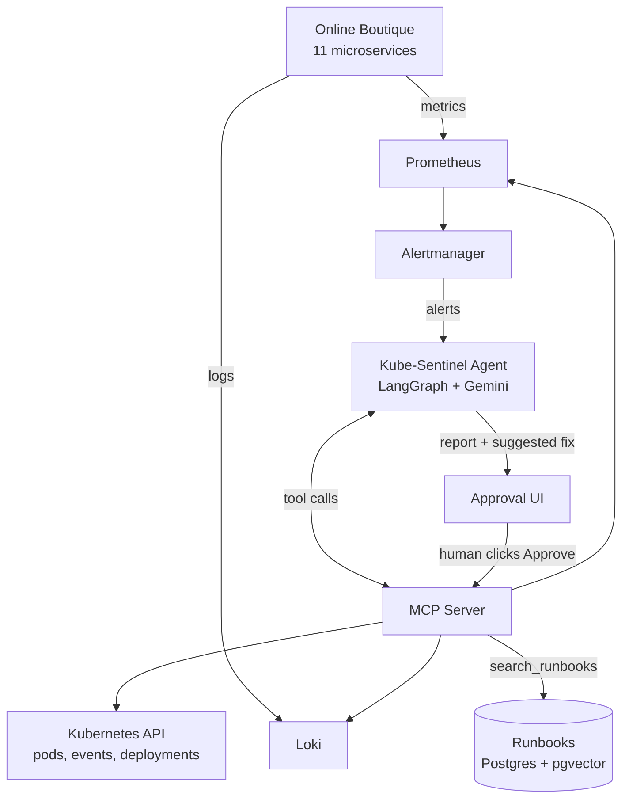

# Kube-Sentinel

**An AI SRE agent for Kubernetes.** When something breaks, Kube-Sentinel investigates the cluster the way an on-call engineer would (pods, events, logs, metrics, recent changes, runbooks), finds the root cause, and suggests a fix that runs only after a human approves it.

> 🚧 **Work in progress.** See the [roadmap](#roadmap) for what's done.

---

## The problem

Alerts say **what** is wrong, not **why**. One failure usually fires many alerts at once:

```
🔴 frontend: 5xx error rate > 5%
🔴 checkoutservice: p99 latency > 2s
🔴 cartservice: error rate high
```

None of these names the cause: **the Redis cart database was scaled to 0.** An engineer typically spends 30–90 minutes connecting logs, metrics and recent changes to work that out. Kube-Sentinel does that investigation automatically.

## How it works



1. A failure happens in the shop (e.g. Redis goes down → cart fails)
2. Alertmanager sends the alert to the agent
3. The agent investigates using MCP tools: pod status and events, logs (Loki), metrics (Prometheus), recent deployments, runbooks (RAG)
4. The agent writes a report: **root cause, evidence, suggested fix**
5. A human clicks **Approve**, and only then does the agent apply the fix

### Example report

```
Root cause: redis-cart was scaled to 0 replicas at 14:02.
Evidence:
  - cartservice logs: "RedisConnectionException: connection refused"
  - deployment redis-cart: 0/0 replicas
  - event: "Scaled down replica set redis-cart to 0"
All 3 active alerts are caused by this one problem.
Runbook: runbooks/cart-redis.md#fix
Suggested fix: kubectl scale deployment/redis-cart --replicas=1   [Approve] [Reject]
```

## Safety by design

- **Read-only by default.** The MCP server's investigation tools can only read cluster state.
- **Allowlisted fixes.** Only a small set of actions (scale, rollout restart, rollout undo) can be suggested.
- **Human in the loop.** No change is applied without explicit approval in the [approval UI](ui/), and every fix is verified afterwards.

## Tech stack

| Layer | Tools |
|---|---|
| Test app | [Online Boutique](https://github.com/GoogleCloudPlatform/microservices-demo) (Google's 11-service demo shop) |
| Cluster | Kubernetes (minikube) |
| Observability | Prometheus, Alertmanager, Grafana, Loki, Grafana Alloy |
| Agent | Python, LangGraph, Gemini |
| Tools | Model Context Protocol (MCP) server |
| Knowledge | RAG over runbooks: PostgreSQL + pgvector, hybrid search (vector + full-text, RRF), local bge-small embeddings |
| UI | Approval web app (FastAPI + plain HTML/JS) |

## Project structure

```
kube-sentinel/
├── scripts/      # cluster setup (deploys Online Boutique)
├── monitoring/   # Prometheus, Grafana, Loki setup
├── chaos/        # scripts that break the shop on purpose (+ undo)
├── mcp_server/   # tools the agent uses to read cluster data
├── agent/        # LangGraph investigation agent
├── runbooks/     # SRE fix guides the agent searches and cites
├── rag/          # Postgres + pgvector, ingest, hybrid search, retrieval eval
├── ui/           # Approve / Reject page
└── docs/         # diagrams, screenshots
```

## Quick start

**Requirements:** Docker, minikube, kubectl, Helm, Python 3.11+.

```bash
minikube start --cpus=6 --memory=10g
./scripts/setup.sh          # deploys the shop (Windows: .\scripts\setup.ps1)
./monitoring/install.sh     # Prometheus, Grafana, Alertmanager, Loki, Alloy
./rag/install.sh            # Postgres + pgvector, loads the runbooks (after pip install, below)
```

| UI | Command | URL |
|---|---|---|
| Shop | `kubectl port-forward svc/frontend 8080:80` | http://localhost:8080 |
| Grafana | `kubectl port-forward -n monitoring svc/kps-grafana 3000:80` | http://localhost:3000 (admin / kube-sentinel) |
| Approval UI | `python -m ui --watch` | http://127.0.0.1:8000 |

Break something on purpose, and put it back:

```bash
python chaos/chaos.py list
python chaos/chaos.py break redis-down
python chaos/chaos.py restore redis-down
```

See what the AI will see, through the MCP server:

```bash
python -m venv .venv && .venv\Scripts\activate && pip install -r requirements.txt
python -m mcp_server.try_tools                # cluster_overview
```

Let the agent investigate (needs a free [Gemini API key](https://aistudio.google.com) in `.env`, see [agent/](agent/)):

```bash
python -m agent "Frontend is returning errors"   # one investigation
python -m agent.watch                            # investigate automatically when alerts fire
```

Review and approve fixes in the browser:

```bash
python -m ui --watch      # http://127.0.0.1:8000, investigates new alerts automatically
```

## Roadmap

- [x] Deploy Online Boutique on minikube
- [x] Monitoring: Prometheus, Grafana, Alertmanager, Loki, Alloy ([details](monitoring/))
- [x] Failure scripts: 5 failure scenarios with known root causes ([details](chaos/))
- [x] MCP server: 16 read-only investigation tools + 3 opt-in fix actions ([details](mcp_server/))
- [x] AI agent: LangGraph + Gemini investigation loop, alert watcher, fast alert rules ([details](agent/))
- [x] RAG runbooks: 10 runbooks, hybrid search on Postgres + pgvector, Recall@3 100% ([details](runbooks/))
- [x] Approval UI: review reports, preview, approve or reject fixes, verified recovery ([details](ui/))
- [ ] Demo GIF

## Results

| Scenario | What broke | Agent's diagnosis | Fix (after approval) | Time |
|---|---|---|---|---|
| `redis-down` | Cart database scaled to 0 | ✅ redis-cart scaled to zero | scale to 1 | 76s |
| `bad-config` | Checkout points at wrong payment port | ✅ `PAYMENT_SERVICE_ADDR` 50051 → 50052 | rollout undo | 39s |
| `oom-kill` | Ads service memory limit too low | ✅ OOMKilled, limit 300Mi → 40Mi | rollout undo | 105s |
| `bad-image` | Image tag that doesn't exist | ✅ ImagePullBackOff, tag v0.10.77 | rollout undo | 155s |
| `bad-probe` | Health check on the wrong port | ✅ liveness probe port 7000 → 7001 | rollout undo | 43s |

**5 / 5 correct** from the same vague alert ("the shop is not working properly"), 6-16 tool calls each,
on Gemini's free tier. Every fix was verified healthy after approval. Details in [agent/](agent/#results).

## License

MIT
