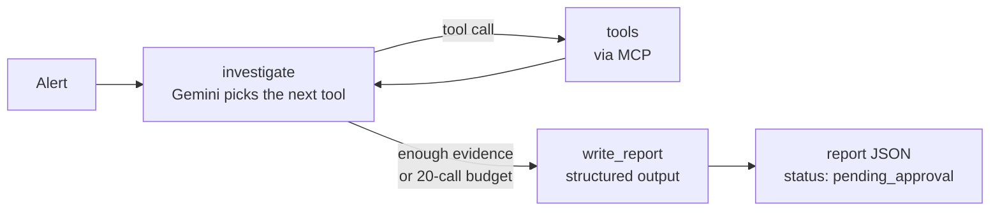

# Agent

A LangGraph + Gemini agent that takes an alert, investigates the cluster through the
[MCP server](../mcp_server/), and writes an incident report: **root cause, evidence and one suggested fix**.
It can only read; the fix runs only after a human approves it.

## How it works



| File | Role |
|---|---|
| [`graph.py`](graph.py) | The LangGraph state machine: `investigate` ⇄ `tools` loop, then `write_report` |
| [`prompts.py`](prompts.py) | How to investigate like an on-call SRE: follow errors to their source, always check what changed |
| [`report.py`](report.py) | The report schema (Pydantic). The fix must be one allowlisted action: scale, rollout undo, rollout restart, or none |
| [`models.py`](models.py) | Gemini model pool with automatic fallback on quota / overload errors |
| [`mcp_tools.py`](mcp_tools.py) | Connects to the MCP server and gives Gemini **only the read-only tools** |
| [`run.py`](run.py) | One investigation end to end; saves the report to `reports/` |
| [`watch.py`](watch.py) | Automatic mode: watches Alertmanager and investigates when shop alerts fire |

## Run it

Needs a free Gemini API key from [Google AI Studio](https://aistudio.google.com), in `.env`:

```bash
GOOGLE_API_KEY=your-key            # .env is git-ignored
# optional: models to try in order (default shown)
GEMINI_MODELS=gemini-3.5-flash,gemini-3.5-flash-lite,gemini-3.1-flash-lite,gemini-3.7-flash
```

[`models.py`](models.py) moves to the next model automatically when one is out of daily quota or
overloaded (free-tier quotas are per model), so an investigation keeps going instead of failing.

```bash
python chaos/chaos.py break redis-down
python -m agent "Frontend is returning errors"     # one investigation, live tool calls
python -m agent.watch                              # or: wait for alerts and investigate automatically
```

## Example: `redis-down`

```
Alert: Shop alert: frontend is returning errors to users.
  -> cluster_overview()
  -> rollout_history({"name": "redis-cart"})
  -> get_events({"object_name": "redis-cart"})
  -> get_pod_logs({"name": "cartservice", "tail_lines": 20})
  -> get_pod_logs({"name": "frontend", "tail_lines": 20})
  -> describe_deployment({"name": "redis-cart"})
======================================================================
Summary:     The redis-cart deployment was scaled down to zero replicas, causing cartservice
             and frontend to return errors when users access cart features.
Root cause:  The redis-cart deployment replica count was set to 0, leaving the redis-cart service
             with no endpoints and causing StackExchange.Redis connection timeouts in cartservice.
Component:   redis-cart  (scaled-to-zero)
Evidence:
  - cluster_overview: deployment redis-cart desired=0, ready=0, state 'scaled to zero'
  - get_events redis-cart: 'Scaled down replica set redis-cart-c8ff86559 from 1 to 0'
  - get_pod_logs cartservice: 'RedisConnectionException: It was not possible to connect to the redis server(s)'
  - get_pod_logs frontend: 'could not retrieve cart: ... Can't access cart storage' with HTTP 500
Suggested fix: kubectl scale deployment/redis-cart --replicas=1
Confidence:  high
======================================================================
6 tool calls, 75.6s, model gemini-3.5-flash
```

## Results

| Scenario | Found the right component? | Right fix? | Tool calls | Time |
|---|---|---|---|---|
| `redis-down` | ✅ redis-cart (scaled-to-zero) | ✅ scale to 1 | 6 | 76s |
| `bad-config` | ✅ checkoutservice (misconfiguration: port 50052) | ✅ rollout undo | 9 | 39s |
| `oom-kill` | ✅ adservice (oom-killed: memory 300Mi → 40Mi) | ✅ rollout undo | 6 | 105s |
| `bad-image` | ✅ productcatalogservice (image-pull-error: tag v0.10.77) | ✅ rollout undo | 16 | 155s |
| `bad-probe` | ✅ currencyservice (bad-probe: liveness port 7001) | ✅ rollout undo | 8 | 43s |

**5 / 5 root causes and fixes correct**, each from the generic alert *"Users report that the shop is not
working properly"*. The last three were run from the approval UI: the human approved each fix, it ran
through the MCP server, and the deployment was verified healthy again within 5-10 seconds.
`oom-kill` was diagnosed correctly even with 7 unrelated "recently restarted" pods right after a cluster reboot.

**A lesson from testing:** in one early run the agent blamed a deployment that had just been *restored*
from a previous test: its "recent change" was the fix, and its old warnings were still in the event window.
Two fixes came out of it: `rollout_history` now flags rollbacks (`latest_revision_is_rollback`), and
`chaos.py restore` deletes the broken ReplicaSet so every test starts clean.

> **Free-tier note:** Gemini's free tier allows about 20 requests per day per model, and one investigation
> uses 5-15. With automatic model fallback that's a few investigations per day; for more, enable billing in AI Studio.

## Alerts

Alerts come from [`monitoring/alert-rules.yaml`](../monitoring/alert-rules.yaml) (Prometheus: scaled to zero,
no available pods, CrashLoop/ImagePull, restart loops, stuck rollouts; fire in 1-3 minutes) and
[`monitoring/loki-rules.yaml`](../monitoring/loki-rules.yaml) (Loki: error logs, which catches failures that
crash nothing, like a wrong service address).

The watcher **pulls** alerts from Alertmanager through the Kubernetes API instead of receiving a webhook,
so nothing on the machine running the agent has to accept connections from the cluster. One incident
fires several alerts; the watcher waits 45s for related alerts and runs **one** investigation for the group.

## Design notes

- **Separate investigate and report steps.** Investigating needs free-form tool calling; the report needs a
  strict schema. Doing them in two steps keeps both reliable, and the report writer only sees facts from the
  transcript.
- **Cited runbooks.** Once it suspects a cause, the agent calls `search_runbooks` once and cites the
  section it used (`runbooks/oom-killed.md#confirm`). A citation that doesn't match a real runbook file
  is dropped.
- **"No incident" is a valid answer.** When nothing is wrong (a healthy shop, or a blip that already
  recovered), the agent reports category `no-incident` with no fix, and the report skips approval.
  Without this it tended to blame something anyway, e.g. an unused optional setting. The prompt also
  lists this shop's known background noise (rejected `visa_electron` test cards, the optional shopping
  assistant), and says not to restart services that have already recovered.
- **Tool budget.** At most 20 tool calls (`KUBE_SENTINEL_MAX_TOOL_CALLS`); then the agent must conclude.
- **No write access.** Fix actions aren't even given to the model. The report names a fix; the approval UI runs it.
- **Own MCP adapter.** `langchain-mcp-adapters` only supports MCP < 2, so `mcp_tools.py` wraps MCP 2.x tools
  as LangChain tools in ~40 lines.
