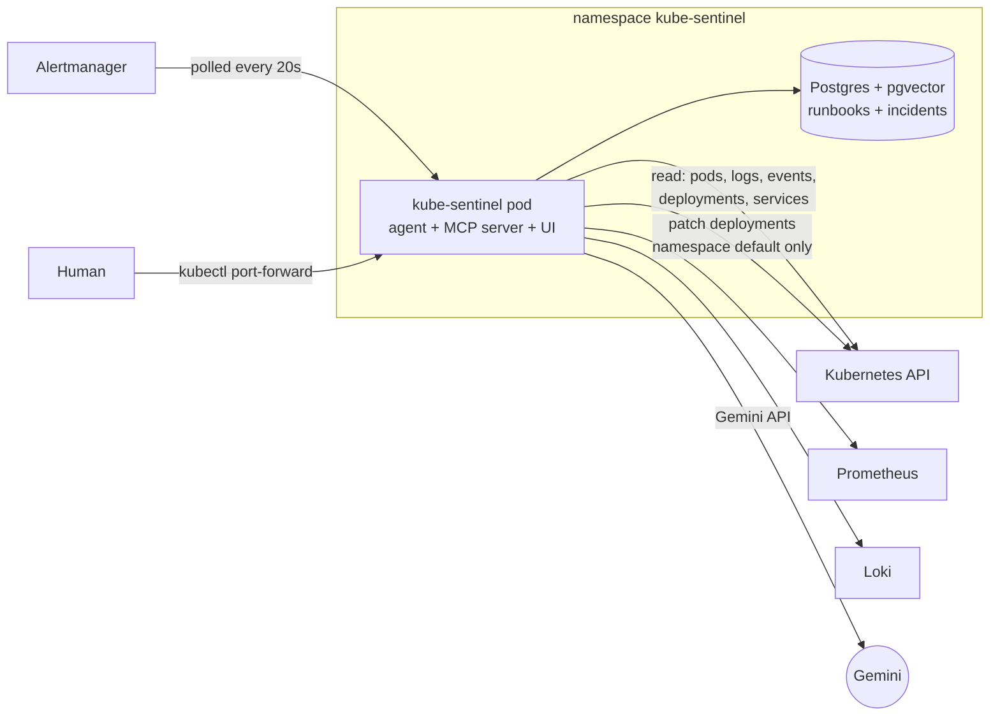

# Deploy: Kube-Sentinel inside the cluster

The agent, MCP server and approval UI ship as **one container image** and install with a **Helm chart**.
Running in the cluster means it watches alerts 24/7 (not only while a laptop is awake), restarts itself if it
crashes, and acts with its **own least-privilege identity** instead of an admin's kubeconfig.

```bash
./deploy/install.sh        # build the image into minikube, create the key Secret, helm install
kubectl -n kube-sentinel port-forward svc/kube-sentinel 8090:8000    # then open http://127.0.0.1:8090
```



## What's in the chart

| Piece | Choice | Why |
|---|---|---|
| Image | `python:3.12-slim`, non-root user `10001`, embedding model baked in | Small attack surface; no model download at runtime |
| `.dockerignore` | excludes `.env`, `.venv`, `reports/`, `.git` | The Gemini key can never end up in an image |
| Gemini key | `existingSecret` created outside the chart | The key never lives in values files or Git |
| Database password | `secretKeyRef` + Kubernetes `$(VAR)` expansion in the connection string | Stays in the Secret |
| Pod security | `runAsNonRoot`, `readOnlyRootFilesystem`, all capabilities dropped, seccomp `RuntimeDefault` | Restricted Pod Security profile |
| Exposure | `ClusterIP` only, reached with `kubectl port-forward` | The UI can change the cluster and has no login yet |
| Probes | `/healthz` readiness and liveness | Kubernetes restarts it if it hangs |
| Runbooks | loaded into Postgres at startup in a separate short-lived process | Runbooks always match the image; model memory is freed |

## Least-privilege RBAC

Verified with `kubectl auth can-i --as=system:serviceaccount:kube-sentinel:kube-sentinel`:

| Action | Allowed |
|---|---|
| get / list pods, logs, events, services, deployments, ReplicaSets (all namespaces) | yes |
| patch deployments, deployments/scale in `default` | yes (the 3 fix actions) |
| patch deployments in `monitoring` | **no** |
| delete pods or deployments | **no** |
| read Secrets (any namespace, including its own) | **no** |
| create pods, list nodes | **no** |

## Incidents in Postgres

Reports live in an `incidents` table next to the runbooks (a pod's filesystem is lost on restart).
Status changes are single conditional `UPDATE`s, so a fix can't be approved twice: in a test, 8 simultaneous
approvals of one incident → exactly 1 succeeded. `python -m agent.store stats` gives incidents and average
minutes to resolve per component.

## Tested hands-free, in the cluster

1. `python chaos/chaos.py break redis-down`, then nobody touched anything.
2. `ShopDeploymentScaledToZero` (Prometheus) and `ShopErrorLogs` (Loki) fired.
3. The pod picked the alerts up and investigated **on its own**: `redis-cart` scaled to zero, fix
   `scale --replicas=1`, citing `runbooks/cart-redis.md`; 5 tool calls, 52 s.
4. The pod was deleted mid-incident: after the restart it did **not** investigate the same alerts again
   (the watcher checks Postgres for an incident created since the alerts started).
5. A human approved in the UI; the pod scaled `redis-cart` with its own service account and verified it
   healthy in 5 s.

### Lessons from deploying it

- **Kube-Sentinel's own pod was OOMKilled** (exit 137) at a 1 GiB limit: two Python processes (the web app
  and the MCP server it starts) plus the embedding model. Fixes: runbook loading moved to a short-lived
  process (resident memory dropped from ~880 MiB to ~150 MiB idle, ~510 MiB peak during an investigation)
  and the limit raised to 2 GiB.
- **Each restart re-investigated the same alerts**, burning LLM quota. The watcher now remembers through
  Postgres instead of process memory.
- **The MCP client starts the server with a filtered environment**, which silently dropped the in-cluster
  settings (`KUBERNETES_SERVICE_HOST`, Prometheus/Loki/DB URLs). It worked on a laptop only because of
  the kubeconfig fallback. The agent now passes its environment through explicitly, minus the variable
  that enables fix actions.
