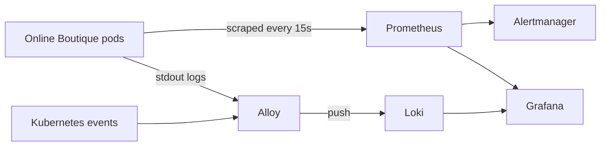

# Monitoring

Gives the agent something to investigate: **metrics**, **logs**, **Kubernetes events** and **alerts**.
Everything runs in the `monitoring` namespace.

| Component | Chart | What it gives the agent |
|---|---|---|
| Prometheus | `prometheus-community/kube-prometheus-stack` 93.2.0 | CPU, memory, restarts, pod readiness (via kube-state-metrics, node-exporter, kubelet/cAdvisor) |
| Alertmanager | (same chart) | Fires alerts; later sends them to the agent by webhook |
| Grafana | (same chart) | Dashboards for humans; Prometheus + Loki pre-connected |
| Loki | `grafana-community/loki` 21.2.1 | Stores logs from every pod (Monolithic mode, local disk, 3-day retention) |
| Grafana Alloy | `grafana/alloy` 1.15.0 | Collects pod logs **and Kubernetes events** (OOMKilled, BackOff, Scaled...) and pushes them to Loki |



## Install

Requires [Helm](https://helm.sh/docs/intro/install/).

```bash
./monitoring/install.sh
```

## Open the UIs

```bash
kubectl port-forward -n monitoring svc/kps-grafana 3000:80
```
http://localhost:3000, login `admin` / `kube-sentinel` (local demo only).

```bash
kubectl port-forward -n monitoring svc/kps-kube-prometheus-stack-prometheus 9090:9090
```
```bash
kubectl port-forward -n monitoring svc/loki 3100:3100
```

## Dashboard: Kube-Sentinel / Shop overview

Installed by `install.sh` from [`dashboards/shop-overview.json`](dashboards/shop-overview.json) (a ConfigMap
labelled `grafana_dashboard: "1"`, which Grafana's sidecar loads automatically). Open it under
**Dashboards → Kube-Sentinel / Shop overview**.

| Panel | Shows |
|---|---|
| Status tiles | Deployments down, scaled to zero, pods not ready, restarts (1h), metric alerts firing, error log lines (5m) |
| Memory per pod / Memory % of limit | Usage over time, and how close each pod is to an OOMKill |
| CPU per pod / Restarts (per 5m) | Load, and crash loops as they happen |
| Pods available per deployment | A line dropping to 0 = a service is down |
| Error log lines per app / Latest error logs | From Loki: where failures surface, and the actual lines |

The built-in **Kubernetes / Compute Resources** dashboards show "No data" for CPU and memory on this setup
(see the first note below); this dashboard uses per-pod queries so it works on minikube and on real clusters.

## Useful queries

**Prometheus (PromQL)**
```promql
# CPU per shop pod (cores)
sum by (pod) (rate(container_cpu_usage_seconds_total{namespace="default"}[2m]))
# Memory per shop pod
sum by (pod) (container_memory_working_set_bytes{namespace="default"})
# Pods that are not ready
kube_pod_status_ready{namespace="default", condition="false"} == 1
# Container restarts in the last 15 minutes
increase(kube_pod_container_status_restarts_total{namespace="default"}[15m]) > 0
```

**Loki (LogQL)**
```logql
{app="cartservice"}                          # all cart logs
{namespace="default"} |~ "(?i)error|exception"   # errors across the shop
{job=~".*kubernetes-events.*"} |= "redis-cart"   # events about redis-cart
```

## Notes

- On minikube with the Docker driver, cAdvisor reports CPU/memory **per pod**, not per container, so
  queries filtering on `container!=""` return nothing. Use `sum by (pod)` as above. Every shop pod has
  one container, so nothing is lost. This is why the built-in Compute Resources dashboards are empty here
  (their queries require `container` and `image` labels); on clusters using the containerd runtime
  (GKE, EKS, AKS) they work as-is.
- etcd, scheduler, controller-manager and kube-proxy scraping is disabled because minikube doesn't
  expose them, which would otherwise fire false "target down" alerts.
