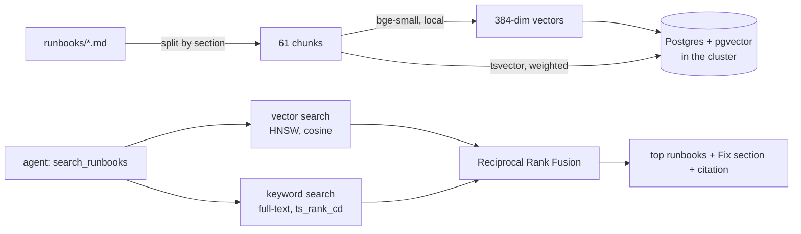

# Runbooks (RAG)

Ten SRE runbooks the agent searches during an investigation. Its report **cites** the runbook section
it relied on, so a human can check the suggested fix against the team's own guide.

| Runbook | For |
|---|---|
| [scaled-to-zero](scaled-to-zero.md) | Deployment at 0 replicas, service with no endpoints |
| [oom-killed](oom-killed.md) | OOMKilled, exit code 137, memory limits |
| [image-pull-error](image-pull-error.md) | ImagePullBackOff, bad tags, registry auth |
| [failing-probes](failing-probes.md) | Liveness / readiness probes on the wrong port or too strict |
| [wrong-service-address](wrong-service-address.md) | Healthy pods, but a caller uses the wrong host or port |
| [crash-loop](crash-loop.md) | App exits on startup (not OOM) |
| [stuck-rollout](stuck-rollout.md) | New pods never ready, old ones still serving |
| [cart-redis](cart-redis.md) | Shop-specific: cart path frontend → cartservice → redis-cart |
| [cpu-throttling](cpu-throttling.md) | Latency from CPU limits or saturation |
| [pending-pods](pending-pods.md) | Pods that can't be scheduled |

Each runbook has front matter (`category`, `components`, `keywords`) and the same sections:
Symptoms, Confirm, Likely causes, Fix, Verify, Prevent.

## How search works



- **Storage:** PostgreSQL 17 + pgvector 0.8 as a StatefulSet in the `kube-sentinel` namespace
  ([`rag/k8s/postgres.yaml`](../rag/k8s/postgres.yaml)). One table, one row per section, with an HNSW
  vector index and a GIN full-text index. The password is a random Kubernetes Secret; the code reads it
  through the Kubernetes API and opens a private tunnel, so there's no password in any file.
- **Chunking:** by the runbook's own `##` sections rather than fixed-size windows, so every hit is one
  coherent piece of advice and can be cited as `runbooks/<file>.md#<section>`.
- **Embeddings:** `BAAI/bge-small-en-v1.5` (open source, ~130 MB) running locally through ONNX.
  No API, no cost, no Gemini quota.
- **Hybrid search:** pgvector similarity and Postgres full-text search (title and keywords weighted
  highest), merged with **Reciprocal Rank Fusion** (`1 / (60 + rank)`), so the two very different scores
  don't need calibrating.
- **Filters:** `category` and `component` (component-specific runbooks plus general ones).
- **Served over MCP** as `search_runbooks`. The result includes each runbook's Fix section, which is what
  the agent needs to suggest a remediation.
- **Grounded citations:** a citation in a report must point at a real runbook file, or it's dropped.

## Retrieval quality

30 labelled queries ([`rag/eval_queries.yaml`](../rag/eval_queries.yaml)) phrased the way an on-call
engineer would ask (exact error strings, paraphrases, mixed symptoms), deliberately not copied from the
runbook text:

| Search mode | Recall@1 | Recall@3 | MRR |
|---|---|---|---|
| vector | 97% | 100% | 0.98 |
| keyword | 87% | 97% | 0.92 |
| **hybrid** | **97%** | **100%** | **0.98** |

On this set hybrid matches vector search and clearly beats keyword search. The value of keeping the keyword
side is robustness on exact tokens (error codes, reasons like `CreateContainerConfigError`) as the runbook
collection grows. The one hybrid miss, *"cartservice cannot reach its database"*, still has the right
runbook at rank 2.

## Run it

```bash
./rag/install.sh            # deploy Postgres + pgvector, create the Secret, load the runbooks
python -m rag.ingest        # reload after editing runbooks
python -m rag.search "pod restarts with exit code 137"
python -m rag.evaluate      # the table above (no LLM, no quota)
```
