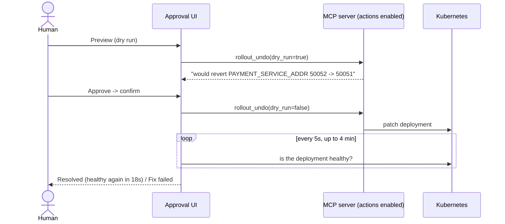

# Approval UI

A small local web app where a human reviews the agent's incident reports and decides what happens:
**Preview** the fix (dry run), **Approve** it (it runs, then recovery is verified), or **Reject** it.
This is the only part of Kube-Sentinel that changes the cluster, and only after a click.

```bash
python -m ui              # http://127.0.0.1:8000
python -m ui --watch      # also investigate automatically when shop alerts fire
```

## What's on the page

- **Shop health** in the header: live, from the cluster (e.g. "1 problem in the shop").
- **Incidents** on the left, newest first, with status: *Investigating… → Waiting for approval →
  Applying fix… → Resolved / Fix failed*, or *Rejected*.
- **A report**: summary, the suggested fix as a command, diagnosis (root cause, component, user impact,
  confidence), evidence, and every tool call the agent made.
- **Investigate now**: start an investigation from a symptom you type; tool calls appear live.

## What happens when you click Approve



## Safety

- Listens on **127.0.0.1 only**: it can change the cluster, so other machines can't reach it.
- Fixes go through the **MCP server's allowlist**: 3 actions, allowed namespaces only, replicas capped.
  The UI can't run arbitrary commands.
- Only reports **waiting for approval** can be approved, and only once (a second click gets HTTP 409).
- Every decision is recorded in the report: approved/rejected, when, the reason, what ran, and whether
  the deployment recovered.

## Storage

Reports are JSON files in `reports/` (git-ignored), one per incident, shared with the agent CLI.
No database: for one cluster and a handful of incidents, files are simpler and easy to inspect.

| File | Role |
|---|---|
| [`server.py`](server.py) | FastAPI app: reports API, approve / reject / preview, live investigations, optional alert watch |
| [`fixer.py`](fixer.py) | Runs the approved action over MCP, then waits for the deployment to be healthy |
| [`store.py`](store.py) | Reads and updates report files |
| [`static/`](static/) | The page: plain HTML, CSS and JavaScript, no build step |
